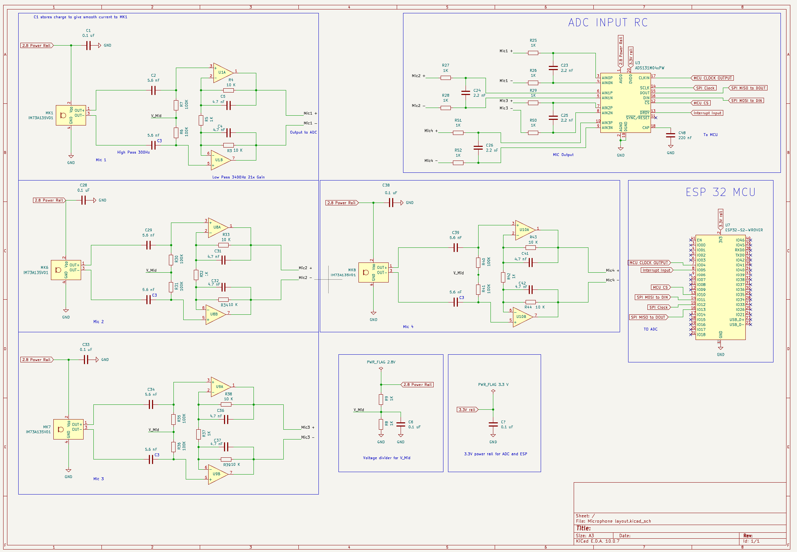
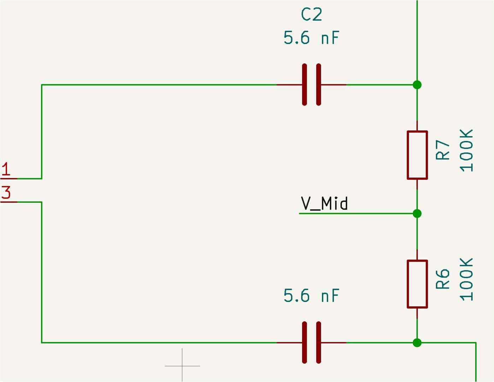
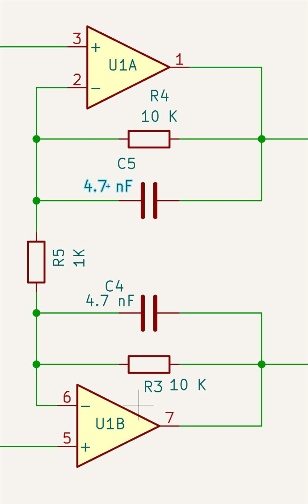
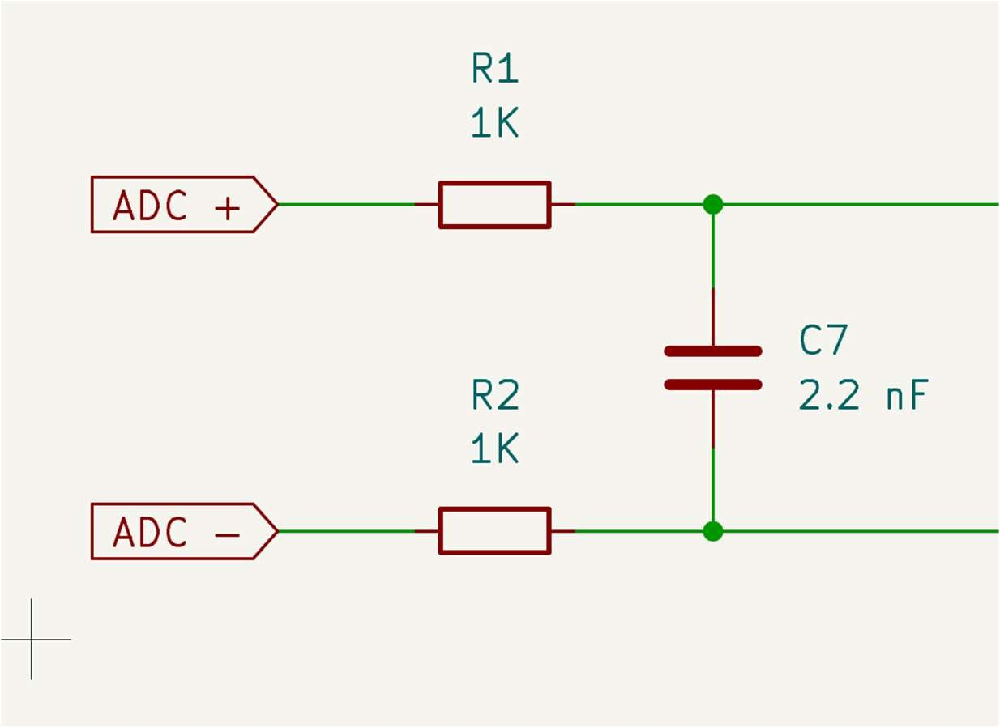
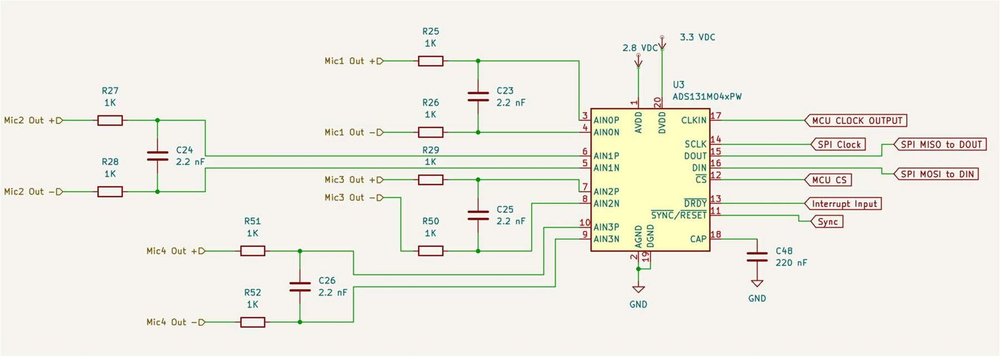

<!-- INTRO -->

  
A four-microphone square array that tracks a person speaking as they move around a room. Omnidirectional microphones, preamplifiers, a four-channel analog-to-digital converter (ADC) and a microcontroller work together to locate the speaker using time difference of arrival (TDoA): the tiny delays between when a sound reaches each microphone.

  
This is an ongoing project. This page summarizes the design decisions so far and the reasoning behind them, and some parts and values may change as the design develops.

  
<a href="/assets/docs/working-technical-report.pdf">Read the full working technical report (PDF)</a>

<!-- ============ SYSTEM OVERVIEW ============ -->
<section class="build-step">
  <h2>System overview</h2>
  

    <figure class="schematic">
      
      <figcaption>Full circuit schematic, drawn in KiCad.</figcaption>
    </figure>
  

  

    <!-- System overview text -->
    
The circuit has four identical microphone channels. Each microphone feeds its own preamplifier, which amplifies and filters the signal before it reaches a shared four-channel ADC. The ADC passes the digitized audio to an ESP32-S2 microcontroller, which will run the localization.

    
The analog circuitry runs from a 2.8 V rail, and a separate 3.3 V rail powers the ADC’s digital side and the microcontroller.

  

</section>

<!-- ============ ARRAY GEOMETRY ============ -->
<section class="build-step text-only">
  <h2>Array shape and spacing</h2>
  

    <!-- Array geometry text -->
    
The shape of the array was the most fundamental decision, because TDoA depends directly on where the microphones sit relative to each other. The speaker’s horizontal angle matters most, so I kept all four microphones in one plane rather than taking on the added complexity of a 3D layout [1]. Two microphones can find an angle but can’t tell which side of their axis a sound came from. Three resolve that, and four improve position precision [2] without adding much mathematical or geometric complexity.

    
The spacing comes from the speech band. Most of the information in human speech sits between 300 and 3400 Hz [3]. At 3400 Hz and a speed of sound of 343.14 m/s in a 20 °C room [4], the wavelength is λ = v / f ≈ 0.101 m. To prevent spatial aliasing, the largest distance across the array should be no more than half a wavelength, about 5 cm. Using that as the corner-to-corner diagonal gives a side length of 5 / √2 ≈ 3.54 cm.

  

</section>

<!-- ============ MICROPHONE PREAMP ============ -->
<section class="build-step">
  <h2>Microphone preamp</h2>
  

    <figure class="schematic">
      
      <figcaption>High-pass filter at the microphone outputs.</figcaption>
    </figure>
    <figure class="schematic">
      
      <figcaption>Op-amp gain stage with the low-pass filter in its feedback.</figcaption>
    </figure>
  

  

    <!-- Microphone preamp text -->
    
Each channel starts with an Infineon IM73A135V01, a high-range analog MEMS microphone with a sensitivity of 12.6 mV/Pa rms (−38 dBV) [5]. The exact microphone may change depending on part availability.

    
A normal voice reaching the microphone at about 60 dB SPL is a pressure of only 0.02 Pa, which produces just 252 µV rms. For the loudest expected input, I used a study’s measured maximum of 79.6 dB SPL at 1 m for normal speech, which gives 2.4 mV rms, or 6.8 mV peak to peak.

    
The ADC’s full differential range is ±1.2 V, so a gain of 352 would fill it completely. Filling the range isn’t necessary, and too much gain adds noise, so I chose a preamp gain of 21 combined with the ADC’s built-in 4× gain, for 84× in total. That puts the loudest expected speech at about 571 mV peak to peak.

    
The preamp also limits the signal to the speech band. A 5.6 nF capacitor with a 100 kΩ resistor sets the high-pass cutoff at 284 Hz (the ideal 5.31 nF isn’t a standard value). The low-pass filter sits in the op-amp feedback, where 4.7 nF capacitors across the 10 kΩ feedback resistors give a cutoff of 3.39 kHz. The two op-amp stages share their gain-setting resistor, so the positive and negative microphone outputs are amplified by exactly the same amount.

  

</section>

<!-- ============ ADC FRONT END ============ -->
<section class="build-step">
  <h2>ADC front end</h2>
  

    <figure class="schematic">
      
      <figcaption>Input RC filter for one channel.</figcaption>
    </figure>
    <figure class="schematic">
      
      <figcaption>All four input filters and the ADS131M04.</figcaption>
    </figure>
  

  

    <!-- ADC front end text -->
    
I chose the Texas Instruments ADS131M04 because it samples all four channels simultaneously, so there’s no timing skew between microphones, which is critical for TDoA. Its analog supply can also run from the same 2.8 V rail as the rest of the analog circuitry.

    
A 1 kΩ resistor after each op-amp output isolates the preamp from the ADC and keeps spikes from the ADC’s input from feeding back into the op-amps. Because the ADC’s input impedance is 330 kΩ [6], these resistors cost very little signal: the voltage ratio is 0.994.

    
The ADC samples internally at 4.096 MHz and outputs 32 kSPS in low-power mode [6]. Its digital filter removes content at and above 16 kHz, but it can’t remove signals near the sampling frequency, which would alias directly into the audio band. A 2.2 nF capacitor across each pair of 1 kΩ resistors forms an input RC filter with a cutoff of about 36 kHz to remove them. That capacitance is also much larger than the ADC’s 0.74–1.3 pF internal sampling capacitance, which keeps the input smooth.

  

</section>

<!-- ============ MICROCONTROLLER ============ -->
<section class="build-step text-only">
  <h2>Microcontroller</h2>
  

    <!-- Microcontroller text -->
    
For the microcontroller, I chose the ESP32-S2-WROVER. Its clock speed of up to 240 MHz leaves room to process the ADC data quickly on the board [7], and it’s readily available for free to Northeastern students.

    
The ESP32-S2 needs 3.0–3.6 V [7] and the ADC’s digital supply accepts 2.7–3.6 V [6]. Since the ESP32-S2 can’t run from the 2.8 V analog rail, a separate 3.3 V rail powers both, comfortably inside each range.

    
The microcontroller supplies the ADC’s clock input and talks to it over SPI (clock, MISO, MOSI and chip select), and the ADC signals it through a data-ready interrupt whenever new samples are available. The ESP32-S2 can map each of these connections to any of its GPIO pins [7], which keeps the board layout flexible.

  

</section>

<!-- ============ TESTING ============ -->
<section class="build-step text-only">
  <h2>Testing: microphone sensitivity</h2>
  

    <!-- Testing text -->
    
The first step in building the project is designing a small PCB for just the microphone and its power supply. The IM73A135V01 can’t easily be connected to a breadboard or protoboard, so a breakout board makes it possible to test each microphone on its own.

    
The first test checks the microphone’s sensitivity. The datasheet advertises 12.6 mV/Pa rms (−38 dBV) with a tolerance of −37 to −39 dBV [5], and a microphone far outside that range would send poor data to the microcontroller. The test plays a 94 dB SPL tone at 1 kHz, which is exactly 1 Pa of pressure and the frequency the sensitivity is specified at, then measures the peak-to-peak amplitude of the microphone’s differential output on an oscilloscope. The expected outputs across the tolerance range are:

    

      <table class="data-table">
        <thead>
          <tr><th scope="col"></th><th scope="col">Sensitivity (dBV)</th><th scope="col">Sensitivity (mV/Pa)</th><th scope="col">Expected output (mVpp)</th></tr>
        </thead>
        <tbody>
          <tr><th scope="row">Min</th><td>−39</td><td>11.2</td><td>31.7</td></tr>
          <tr><th scope="row">Typical</th><td>−38</td><td>12.6</td><td>35.6</td></tr>
          <tr><th scope="row">Max</th><td>−37</td><td>14.1</td><td>40.0</td></tr>
        </tbody>
      </table>
    

  

</section>

<!-- ============ REFERENCES ============ -->
<section class="references">
  <h2>References</h2>
  <ol>
    <li>A. Dehghan Firoozabadi and H. R. Abutalebi, “Subband processing-based approach for the localisation of two simultaneous speakers,” <cite>IET Signal Process.</cite>, vol. 8, no. 9, pp. 996–1008, 2014. <a href="https://doi.org/10.1049/iet-spr.2013.0475">doi:10.1049/iet-spr.2013.0475</a></li>
    <li>J. Fan, Q. Luo, and D. Ma, “Localization estimation of sound source by microphones array,” <cite>Procedia Eng.</cite>, vol. 7, pp. 312–317, Dec. 2010. <a href="https://doi.org/10.1016/j.proeng.2010.11.050">doi:10.1016/j.proeng.2010.11.050</a></li>
    <li>B. B. Monson, E. J. Hunter, A. J. Lotto, and B. H. Story, “The perceptual significance of high-frequency energy in the human voice,” <cite>Front. Psychol.</cite>, vol. 5, p. 587, Jun. 2014. <a href="https://doi.org/10.3389/fpsyg.2014.00587">doi:10.3389/fpsyg.2014.00587</a></li>
    <li>U.S. Department of Commerce, National Weather Service, “Speed of Sound Calculator.” <a href="https://www.weather.gov/epz/wxcalc_speedofsound">weather.gov</a></li>
    <li>Infineon, IM73A135V01 datasheet. <a href="https://www.infineon.com/assets/row/public/documents/30/49/infineon-im73a135-datasheet-en.pdf">infineon.com</a></li>
    <li>Texas Instruments, ADS131M04 datasheet. <a href="https://www.ti.com/lit/ds/symlink/ads131m04.pdf">ti.com</a></li>
    <li>Espressif, ESP32-S2-WROVER datasheet. <a href="https://documentation.espressif.com/esp32-s2-wrover_esp32-s2-wroveri_datasheet_en.pdf">espressif.com</a></li>
  </ol>
</section>
