<!-- INTRO -->

  
The Revere Smoothie Shop is an interactive, museum-style science exhibit my team of four designed and built in Northeastern’s Cornerstone of Engineering course, drawing on exhibits we studied at the Boston Museum of Science. It teaches elementary school students, ages 6 to 11, about the emissions involved in moving food across the country. Players build a smoothie by choosing where each ingredient comes from and whether it travels to Boston by plane, truck or train, and the exhibit scores them on both freshness and emissions.

  
The whole exhibit had to fit on a 36 × 28 in table, pack into a 27.6 × 13.8 × 16.5 in bag, be safe for young children, and cost less than $100 to build. We finished at $86.48 and presented it at the course expo on April 10, 2026.

<!-- ============ FINISHED EXHIBIT ============ -->
<section class="build-step">
  <h2>The finished exhibit</h2>
  

    

      <a class="thumb" href="/assets/img/museum-of-science.jpg">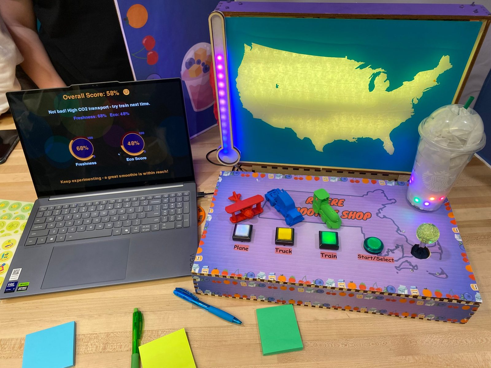</a>
      <a class="thumb" href="/assets/img/museum-of-science/expo-setup.jpg">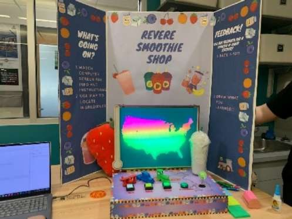</a>
    

  

  

    <!-- Finished exhibit text -->
    
The exhibit has two parts that fit together in a clamshell shape: a top box holding the backlit map of the United States, and a bottom box with the controls. A laser-cut acrylic thermometer on the side of the map shows emissions, and an LED-lit smoothie cup fills with color as the game goes on. A laptop beside the exhibit runs the on-screen interface, and a trifold poster explains the game.

  

</section>

<!-- ============ MY ROLE ============ -->
<section class="build-step">
  <h2>My role</h2>
  

    

      <a class="thumb" href="/assets/img/museum-of-science/cardboard-prototype.jpg">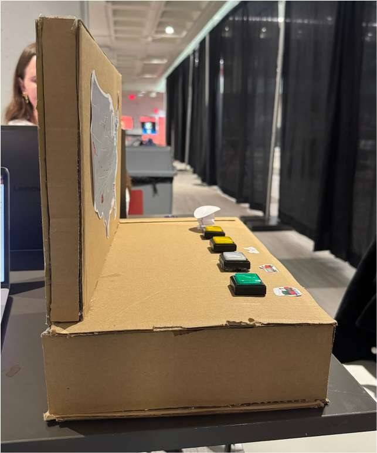</a>
      <a class="thumb" href="/assets/img/museum-of-science/laser-cut-enclosure.jpg">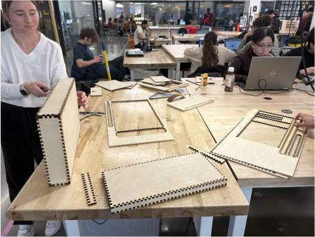</a>
      <a class="thumb" href="/assets/img/museum-of-science/enclosure-assembly.jpg">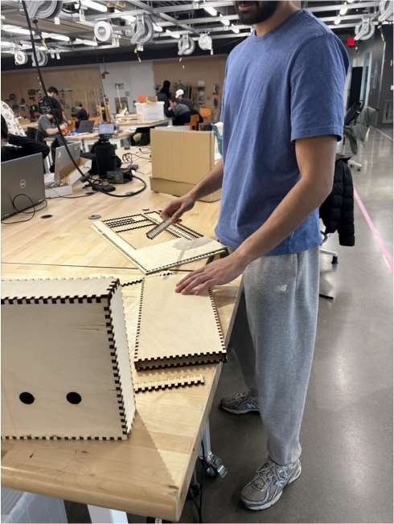</a>
    

  

  

    <!-- My role text -->
    
The food transport topic grew out of an early idea of mine about sorting seeds into the right soil, which led the team toward where food comes from.

    
Early in the project, I tended to dive into tasks first. I drew the first wooden enclosure in AutoCAD and laser-cut it, and I trained on the metal shop tools and large-format printer. Finding problems early let the team refine the design quickly. Later, I focused on the LED map display, the emissions thermometer and the trifold, and on keeping the team’s schedule and purchasing on track.

  

</section>

<!-- ============ HOW IT PLAYS ============ -->
<section class="build-step">
  <h2>How it plays</h2>
  

    

      <a class="thumb" href="/assets/img/museum-of-science/computer-gui.jpg">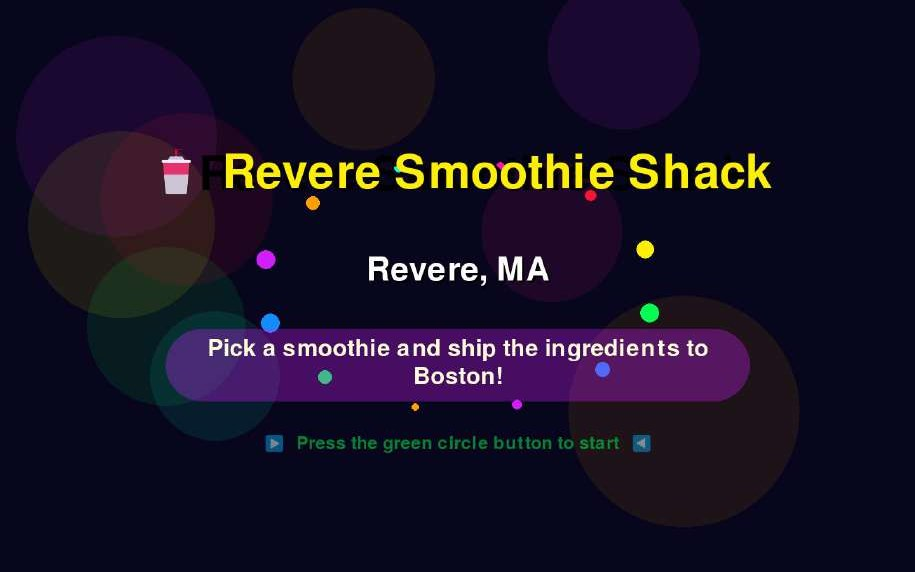</a>
      <a class="thumb" href="/assets/img/museum-of-science/figurines.jpg">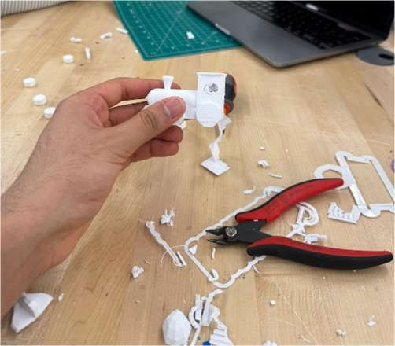</a>
    

  

  

    <!-- How it plays text -->
    
Pressing Start brings up three smoothie options on the laptop screen. Players choose one with a joystick and a select button. For each ingredient, the map lights up the states it could come from. Players pick an origin with the joystick, then choose a vehicle using one of three buttons, each marked with a 3D-printed plane, truck or train.

    
A trail of lights then runs across the map from the origin to Boston at the speed of the chosen vehicle. At the end, the map fades from green to yellow to show how eco-friendly the choices were, and the screen shows the freshness, eco and overall scores with a message before the game resets.

  

</section>

<!-- ============ LED MAP DISPLAY ============ -->
<section class="build-step">
  <h2>The LED map display</h2>
  

    

      <a class="thumb" href="/assets/img/museum-of-science/led-grid-wiring.jpg">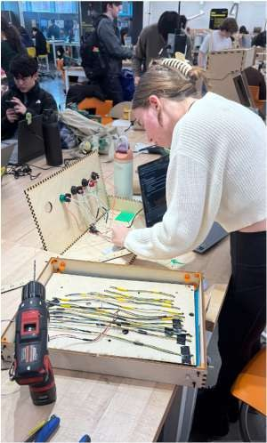</a>
      <a class="thumb" href="/assets/img/museum-of-science/acrylic-map-panel.jpg">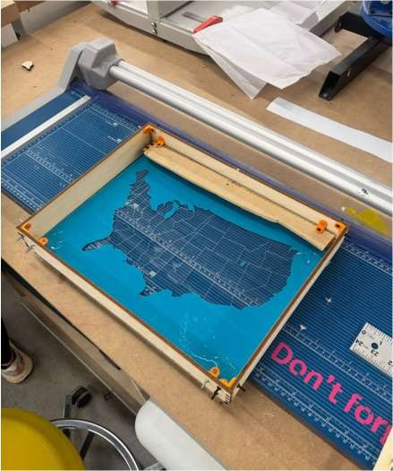</a>
      <a class="thumb" href="/assets/img/museum-of-science/map-box-assembly.jpg">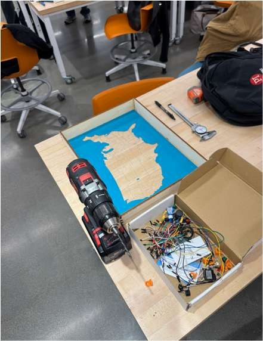</a>
      <a class="thumb" href="/assets/img/museum-of-science/map-lit-test.jpg">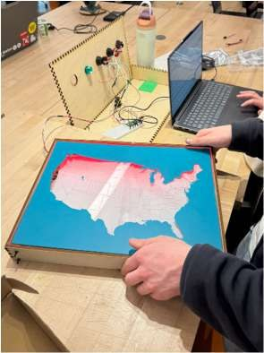</a>
    

  

  

    <!-- LED map display text -->
    
The centerpiece is a backlit map of the contiguous United States. The front panel is a laser-cut acrylic map set into a wooden frame, with a cyan vinyl outline and a diffusing sheet behind it. On the back panel, LED strip segments are arranged in a grid and wired as one continuous strip, with holes drilled at the end of each row so the connecting wires run hidden behind the panel. I soldered the strip together, more than 108 solder joints over about two days, and handled the wire routing. A small gap between the panels diffuses the light so individual bulbs aren’t visible.

    
For the final expo, I rebuilt the display, because the earlier version was flimsy and scratched. I made a new friction-fit enclosure laser-cut to exact dimensions, added 3D-printed L-brackets for stiffness, and mounted the LED backlight with epoxy. I also built the emissions thermometer: an LED strip behind laser-cut acrylic and wood that rises as the game progresses, so players can see their emissions climbing in real time.

  

</section>

<!-- ============ ELECTRONICS AND SOFTWARE ============ -->
<section class="build-step">
  <h2>Electronics and software</h2>
  

    <figure class="schematic">
      <a class="thumb" href="/assets/img/museum-of-science/wiring-diagram.jpg">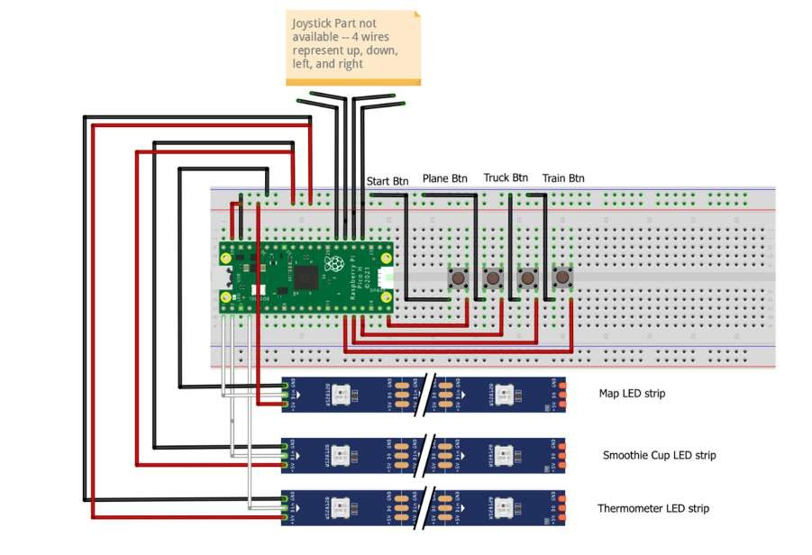</a>
      <figcaption>Wiring diagram for the Pico, controls and LED strips.</figcaption>
    </figure>
    

      <a class="thumb" href="/assets/img/museum-of-science/code-testing.jpg">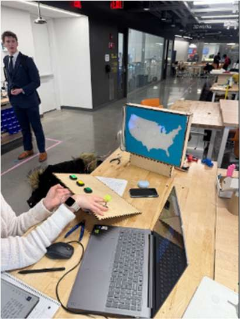</a>
    

  

  

    <!-- Electronics and software text -->
    
A Raspberry Pi Pico reads the three transport buttons, the start/select button and the joystick, and drives the LED strips in the map, thermometer and smoothie cup. It works alongside a laptop interface that shows the instructions, options and scores. My teammates wrote most of the code.

    
The Pico also logged every playthrough, recording the smoothie, ingredient origins, transport choices, and freshness, eco and overall scores, so we could evaluate the exhibit with real data instead of impressions.

  

</section>

<!-- ============ RESULTS ============ -->
<section class="build-step text-only">
  <h2>Results</h2>
  

    <!-- Results text -->
    
The exhibit ran bug-free for the entire expo across 40 logged games. Of the 120 transport decisions players made, fewer than 23% used planes, the highest-emission option, and more than 40% used trains. Players also tended to choose closer origins, like Maine instead of Michigan, and average scores cleared our target of 70.

    
Many kids played a quick trial round and then changed strategy to improve their score. Written feedback was overwhelmingly positive, with the exhibit frequently rated “100/10.”

  

</section>

<!-- ============ WHAT I'D CHANGE ============ -->
<section class="build-step text-only">
  <h2>What I’d change</h2>
  

    <!-- What I'd change text -->
    
I would change the project to be less reliant on the computer interface. The GUI was dazzling and very interesting, but the clients struggled to switch between computer prompts and physical button inputs. This caused confusion and took the users out of the experience.

  

</section>
