<!-- INTRO -->

  
This is my 1977 VW bus, and it’s electric. The project began in 2023 out of my passion for cars and a desire to push myself with technology I’d never worked with before. Its wheels first spun under electric power in 2025, and there’s still always something to work on. This page walks through the main conversion: preparing the engine bay, building the powertrain, and setting up the systems that keep it all running. Much more detail is available in my personal notes and files, so please contact me if you have any questions or want to know more.

  
This project started with my dad and me. As I have become more proficient in the shop and in my understanding of the project as a whole, I took more ownership. I am proud to say that the car is fully mine, and I control its operation and upkeep.

<!-- ============ CAR OVERVIEW ============ -->
<section class="build-step">
  <h2>Car overview</h2>
  

    

      <a class="thumb" href="/assets/img/vw-bus/01-car-overview.jpg">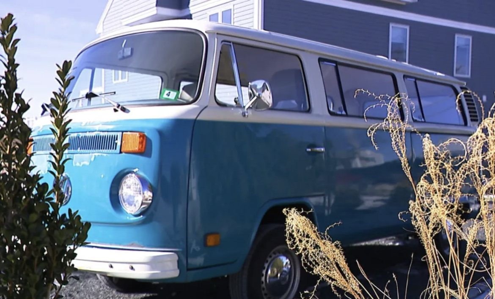</a>
    

  

  

    <!-- Car overview text -->
    
The bus is a 1977 Volkswagen T2 Kombi (short for Kombinationskraftwagen) that spent most of its life in a barn in Vermont. When I found her, she had a minor rust problem and a family of squirrels living in the exhaust pipe (they were pretty friendly).

  

</section>

<!-- ============ ENGINE BAY PREP ============ -->
<section class="build-step">
  <h2>Engine bay prep</h2>
  

    

      <a class="thumb" href="/assets/img/vw-bus/02-engine-bay-prep-1.jpg">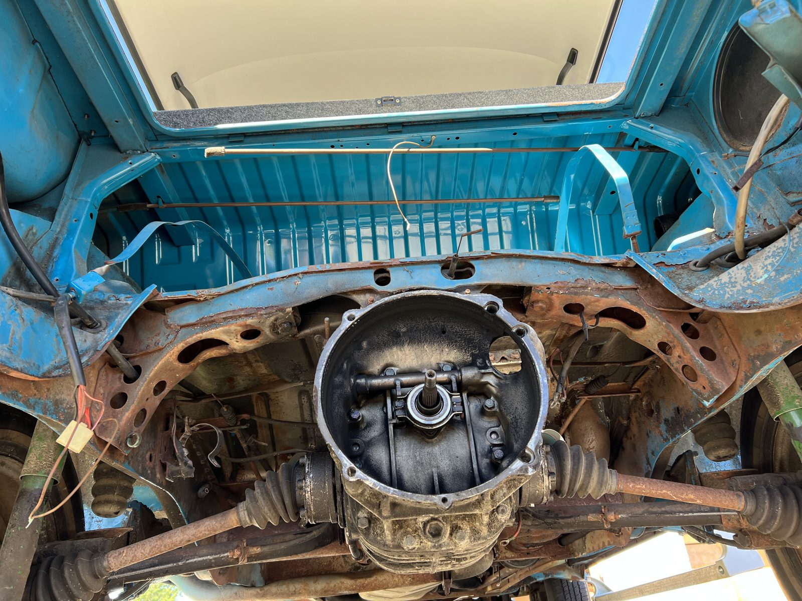</a>
      <a class="thumb" href="/assets/img/vw-bus/02-engine-bay-prep-2.jpg">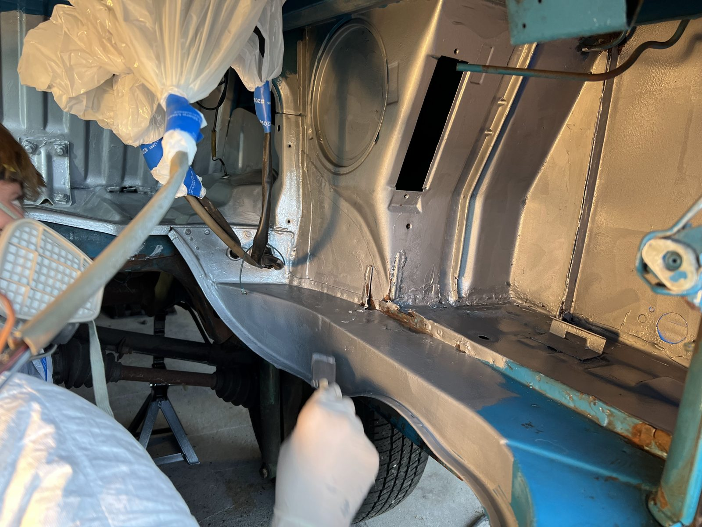</a>
    

  

  

    <!-- Engine bay prep text -->
    
We started by removing the original engine, gas tank, alternator, battery, and most of the rear electronics. A thick layer of dust and grime had built up on nearly every surface, and it came off only with power tools and chemical solvents. Next, we had to deal with the rust. This meant sanding. Then a bit more sanding. And finally, after all that sanding, a bit more sanding to finish it off.

    
In the end, the bay was clean, shiny, and in the sharpest shape it had been in since it rolled out of Germany. We coated every area of bare metal with high-strength marine paint, and the bus was ready to be electrified.

  

</section>

<!-- ============ CREATING THE POWERTRAIN ============ -->
<section class="build-step">
  <h2>Creating the powertrain</h2>
  

    

      <a class="thumb" href="/assets/img/vw-bus/03-powertrain-1.jpg">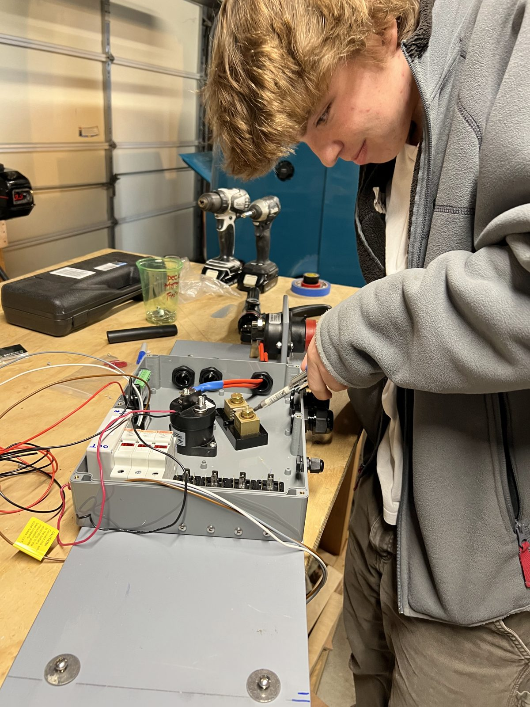</a>
      <a class="thumb" href="/assets/img/vw-bus/03-powertrain-2.jpg">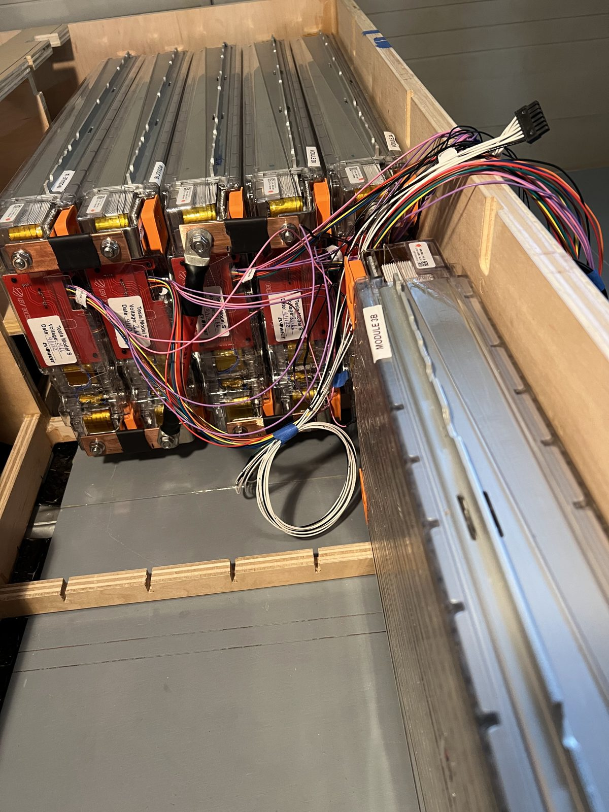</a>
      <a class="thumb" href="/assets/img/vw-bus/03-powertrain-3.jpg">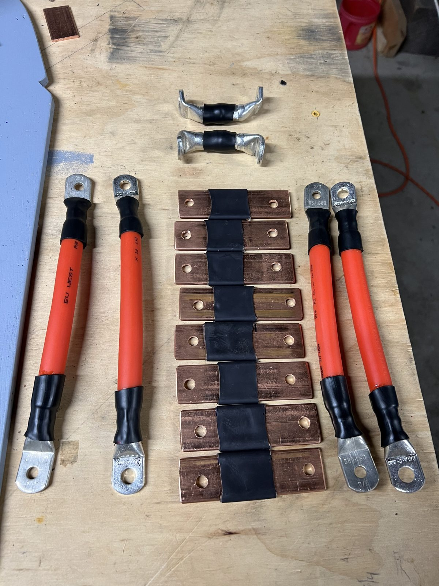</a>
      <a class="thumb" href="/assets/img/vw-bus/03-powertrain-4.jpg">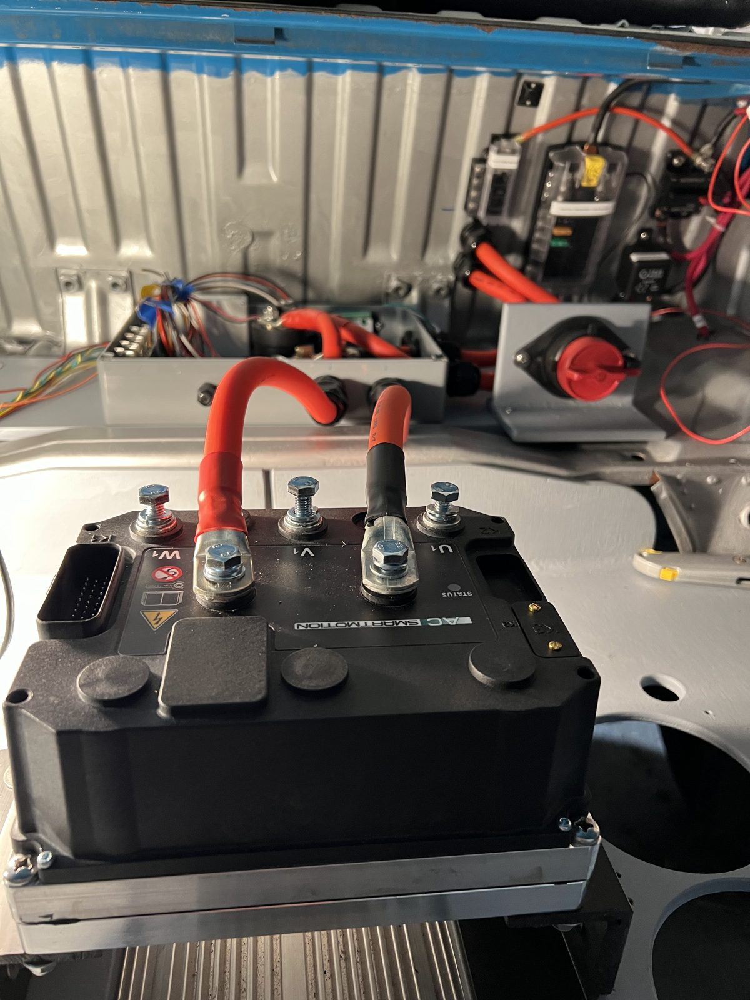</a>
      <a class="thumb" href="/assets/img/vw-bus/03-powertrain-5.jpg">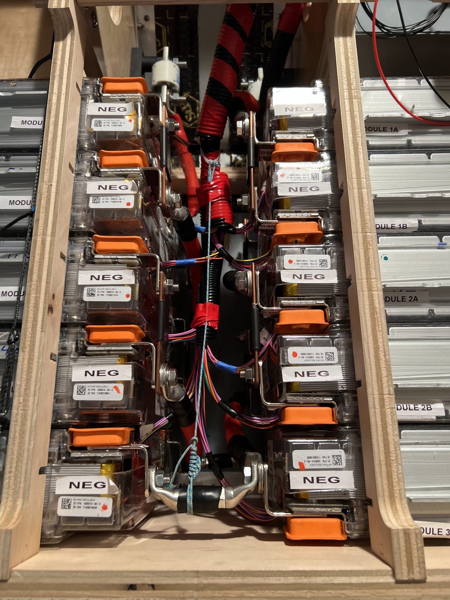</a>
    

    <figure class="schematic">
      <a class="thumb" href="/assets/img/vw-bus/03-powertrain-6-schematic.png">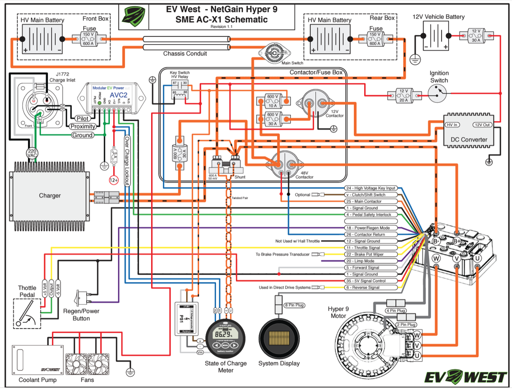</a>
      <figcaption>NetGain Hyper 9 / SME AC-X1 wiring schematic. Source: EV West.</figcaption>
    </figure>
  

  

    <!-- Creating the powertrain text -->
    
The biggest part of this project was the powertrain, starting with the main battery pack. I used Tesla battery modules, each rated at 22.8 V and 232 Ah and made up of six series cell groups at 3.8 V each. I wired the modules in parallel pairs, then connected five of these pairs in series using custom bus bars made from copper bar and leftover 2-gauge cable. This gives the pack a nominal voltage of 114 V and roughly 53 kWh of capacity. Each cell group has a safe range of 3.2–4.2 V, so the full pack operates between 96 V and 126 V, a good match for the motor, a NetGain HyPer 9.

    
Next came the wiring. High-voltage cables run from the battery pack into the contactor box, one of the most important parts of the car. It holds the high-voltage relays, the main switch, the shunt, the charge control, and dozens of signal wires from systems throughout the car. From there, power goes to the motor controller, which uses the throttle input and the motor’s encoder signal to invert the pack’s DC into three-phase AC for the motor.

    
The charging system came next. The bus charges through a J1772 inlet, the standard plug used by most EVs today. It feeds two 6.6 kW Elcon on-board chargers, which convert AC from the charging station into DC for the pack. An AVC2 module handles the J1772 pilot and proximity signals, telling the system when the car is plugged in and the station is ready to supply power. Charging is switched by a relay that the battery management system controls over CAN bus (more on the BMS under Support systems).

    
The last major powertrain system is a DC-DC converter that steps the high-voltage pack down to 12 V for the car’s “house” electronics. When the key is turned on, it draws power from the contactor box and keeps the original 12 V car battery charged.

  

</section>

<!-- ============ SUPPORT SYSTEMS ============ -->
<section class="build-step">
  <h2>Support systems</h2>
  

    

      <a class="thumb" href="/assets/img/vw-bus/04-support-systems-1.jpg">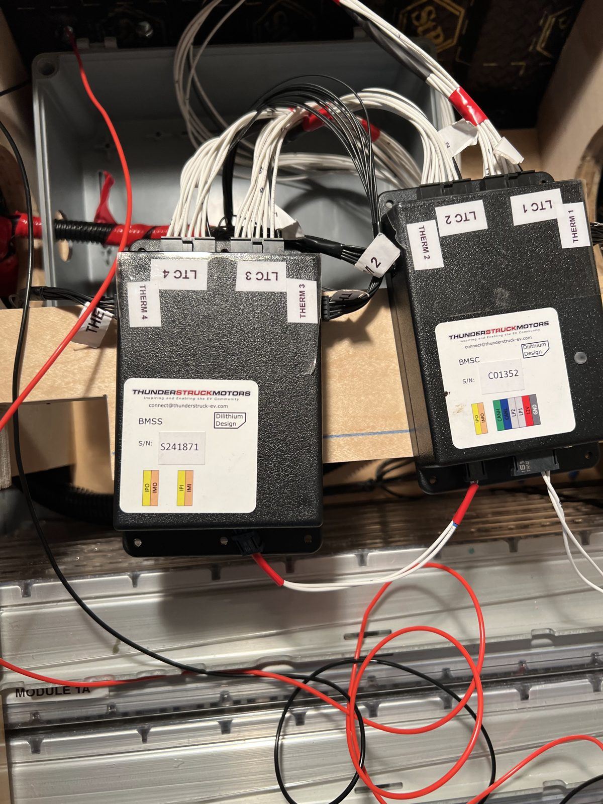</a>
      

        <video controls playsinline preload="metadata" poster="/assets/img/vw-bus/04-support-systems-2-poster.jpg">
          <source src="/assets/img/vw-bus/04-support-systems-2.mp4" type="video/mp4">
          Your browser can’t play this video.
        </video>
      

      <a class="thumb" href="/assets/img/vw-bus/04-support-systems-3.jpg">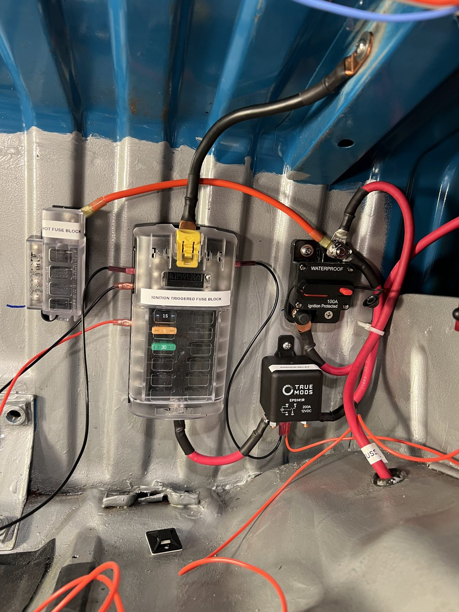</a>
    

  

  

    <!-- Support systems text -->
    
Keeping the car running takes many systems working together. The most important is the BMS, or battery management system: a small computer that reads the voltage and temperature of every cell group in the pack and cuts off charging or driving if anything leaves its safe range. The charge relay and motor controller both rely on its data.

    
A water cooling loop runs throughout the car. A pump circulates coolant through the motor controller and across the top of the battery pack, then through a radiator cooled by electric fans.

    
The brakes presented a bigger challenge. In a gas-powered car, the engine creates a vacuum, and the brake booster uses that vacuum to multiply pedal force. An electric car has to supply it separately. We connected an electric vacuum pump to the original vacuum lines and added a sealed tank to store vacuum, so the pump doesn’t have to run constantly.

    
To power all of these systems, we set up a central 12 V hub. Power runs from the car battery to an always-on bus bar, which feeds two fuse blocks: an always-on block and a key-on block. The always-on block connects to the DC-DC converter and the charge relay. The key-on block powers everything else, including the cooling system, the vacuum pump, and the rest of the original electronics.

  

</section>
